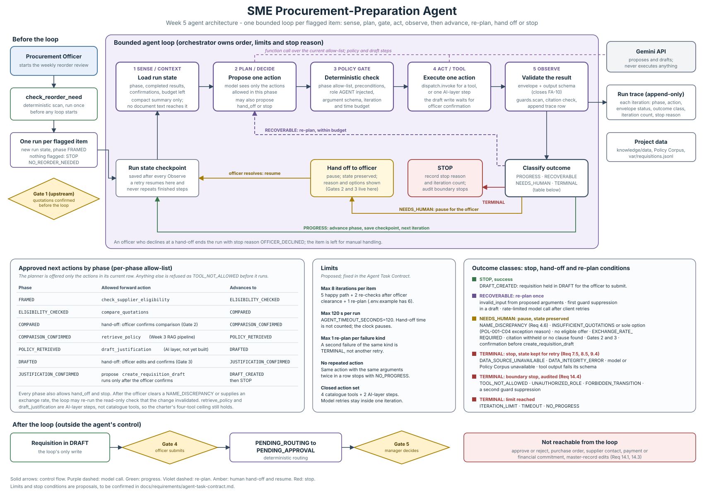

# Agent Architecture Diagram

| Field | Value |
|---|---|
| Week | 5 |
| Owner | Lukaanya George |
| Due | 2 October 2026 |
| Status | Complete, awaiting team review |
| Path | `docs/architecture/agent-architecture.md` |

## Brief requirement

Design Sense/Context → Plan/Decide → Act/Tool → Observe → Stop/Re-plan for one goal-directed multi-step workflow. Show approved tools, iteration/stop limits and human hand-off.

## Write-up

This document designs the loop. The [Agent Task Contract](../requirements/agent-task-contract.md)
(#21) fixes its limits and stop conditions, in
[`contracts/agent-task-contract.json`](../../contracts/agent-task-contract.json), which the code
loads at startup. Where this page and the contract disagree, the contract wins. The loop is built
([`working-agent.md`](working-agent.md), #22) with a deterministic planner and the four
catalogue tools. Section 9 lists which parts of this design are built and which are not.

### 1. The task and why it needs a loop

**Goal.** For one flagged reorder item, prepare a Purchase Requisition in `DRAFT` that a
Procurement Officer can submit. This covers steps 3 to 8 of the Charter section 6 workflow,
which the charter assigns to the Week 5 bounded loop.

A fixed script cannot do this safely, because the next correct action depends on what the
previous one returned:

- An eligibility check can leave zero, one or several eligible suppliers. Zero means there is
  nothing to compare. One means POL-001-C04 needs an exception reason. A `NAME_DISCREPANCY`
  means the officer must decide before the comparison can be trusted (Requirement 4.6).
- A comparison can return `INSUFFICIENT_QUOTATIONS`, `EXCHANGE_RATE_REQUIRED` or an excluded
  offer that the officer can fix. Each needs a different next step.
- Policy retrieval can withhold an item for an invalid citation or find no clause
  (Requirement 7.3). A draft can be suppressed by the guards (Requirement 14.2).
- Once the officer resolves an issue, the loop must continue from where it paused and not
  repeat finished work (Requirements 7.5, 8.5 and 9.4).

The loop's autonomy is deliberately small. It decides which approved action comes next, when
to ask the officer and when to stop. It never decides eligibility, computes a figure, changes a
status or approves anything. These boundaries are unchanged from the
[AI Boundary Matrix](../requirements/ai-boundary-matrix.md).

### 2. Where the loop sits

| Stage | Component | In the loop? |
|---|---|---|
| Officer starts the weekly review | Human | Before it |
| Flag items at or below reorder point | `check_reorder_need`, run once | Before it; one loop run per flagged item |
| Confirm extracted quotation data (Gate 1) | Human | Before it; the tools read confirmed records in `knowledge/data/` |
| Eligibility, comparison, policy, justification, draft | Sections 3 and 4 | **The loop** |
| Submit (Gate 4), route, approve or reject (Gate 5) | Human, then deterministic routing | After it; nothing in the loop can reach these |

Gate 1 and quotation extraction sit before the loop in Week 5, which narrows the charter's
"steps 3 to 8". The Week 4 tools read already-normalised quotations, and document conversion is
still deferred. Connecting extraction output to the loop is a later integration step.

### 3. One iteration

| Step | Owner | What happens | Safety property |
|---|---|---|---|
| **1 Sense / Context** | Orchestrator | Loads the run state checkpoint: current phase, completed results, officer confirmations, remaining budget. Builds a compact summary of status codes, counts and identifiers. | No quotation or policy text reaches the planner, so an instruction embedded in a document has nothing to act through (Requirement 14.5). |
| **2 Plan / Decide** | Gemini, via function calling | Proposes **one** action. The function declarations offered are only the current phase's allow-list plus `hand_off` and `stop`. | The model cannot name an action it was not offered. |
| **3 Policy gate** | Deterministic | Checks the action against the phase allow-list, checks its preconditions, injects `caller_role = AGENT`, validates the arguments and checks the iteration and time budget. | A refusal is returned as an observation. It never executes. |
| **4 Act / Tool** | `dispatch.invoke` or an AI-layer step | Executes exactly one action. `create_requisition_draft` runs only after the officer confirms, and then under the officer's identity. | Existing Week 4 authorization applies unchanged. |
| **5 Observe** | Deterministic | Validates the envelope and the tool's **output schema**, runs `guards.scan`, checks citations for policy output, and appends a trace row. | A malformed result is `TERMINAL`, never data. This closes FA-10 in [`tool-failure-tests.md`](../evaluation/tool-failure-tests.md). |
| **Classify** | Deterministic | Assigns each observation exactly one class: `PROGRESS`, `RECOVERABLE`, `NEEDS_HUMAN` or `TERMINAL` (section 5). | The model never decides whether its own result was good enough. |

The model proposes and the orchestrator disposes. In most phases there is exactly one forward
action, and the choice that matters is between going forward, re-checking, handing off and
stopping.

### 4. Approved actions by phase

| Phase | Forward action | Next phase |
|---|---|---|
| `FRAMED` | `check_supplier_eligibility` | `ELIGIBILITY_CHECKED` |
| `ELIGIBILITY_CHECKED` | `compare_quotations` | `COMPARED` |
| `COMPARED` | hand-off: officer confirms the comparison (Gate 2) | `COMPARISON_CONFIRMED` |
| `COMPARISON_CONFIRMED` | `retrieve_policy` (Week 3 RAG pipeline) | `POLICY_RETRIEVED` |
| `POLICY_RETRIEVED` | `draft_justification` (AI layer, not yet built) | `DRAFTED` |
| `DRAFTED` | hand-off: officer edits and confirms the justification (Gate 3) | `JUSTIFICATION_CONFIRMED` |
| `JUSTIFICATION_CONFIRMED` | propose `create_requisition_draft`; runs after officer confirmation | `DRAFT_CREATED`, then stop |

Rules that hold in every phase:

- `hand_off` and `stop` are always allowed.
- After the officer clears a `NAME_DISCREPANCY` or supplies an exchange rate, the loop may
  re-run the read-only check that the change invalidated: `check_supplier_eligibility`, then
  `compare_quotations`.
- Nothing else is callable. `retrieve_policy` and `draft_justification` are AI-layer steps, not
  catalogue tools, so the charter's four-tool ceiling still holds. The Week 4 decision to keep
  policy retrieval off the tool allow-list stands until Week 6.
- Gates 2 and 3 are hand-offs, not actions. The loop cannot confirm on the officer's behalf.

**Hand-offs are batched.** Read-only findings that need the officer, such as a
`NAME_DISCREPANCY` from eligibility or `INSUFFICIENT_QUOTATIONS` from comparison, are raised
together at Gate 2, which the officer must pass anyway. This way the officer is interrupted
once rather than after every tool. The exception is a comparison with no eligible offer: that
hands off immediately, because there is nothing to confirm.

### 5. Outcome classes

| Class | Triggers | Loop behaviour |
|---|---|---|
| `PROGRESS` | `ok` or `no_result` that satisfies the phase | Advance the phase, save the checkpoint, next iteration |
| `RECOVERABLE` | `invalid_input` from model-proposed arguments; first guard suppression in a draft; model call still rate-limited after the client's bounded retries | Re-plan once, within budget; a second failure of the same kind is `TERMINAL` |
| `NEEDS_HUMAN` | `NAME_DISCREPANCY`; `INSUFFICIENT_QUOTATIONS` or `sole_eligible_option` (POL-001-C04 exception reason); no eligible offer; `EXCHANGE_RATE_REQUIRED`; citation withheld or no clause found; Gates 2 and 3; confirmation before `create_requisition_draft` | Pause with the reason and options shown; state preserved; the officer resolves and the loop resumes, or declines and the run stops with `OFFICER_DECLINED` |
| `TERMINAL`, state kept | `DATA_SOURCE_UNAVAILABLE`, `DATA_INTEGRITY_ERROR`, model or Policy Corpus unavailable, output fails its schema | Stop; a retry resumes from the checkpoint without repeating earlier steps (Requirements 7.5, 8.5, 9.4) |
| `TERMINAL`, boundary | `TOOL_NOT_ALLOWED`, `UNAUTHORIZED_ROLE`, `FORBIDDEN_TRANSITION`, second guard suppression | Stop, show a blocked-action error and write an audit entry (Requirement 14.4); never retried |
| `TERMINAL`, limit | `ITERATION_LIMIT`, `TIMEOUT`, `NO_PROGRESS` | Stop, record the limit reached |

Successful stop reasons are `DRAFT_CREATED` and, before any loop starts, `NO_REORDER_NEEDED`.
Every run ends with exactly one stop reason in the trace, as Charter section 6 step 10
requires.

### 6. Limits

The Agent Task Contract (section 7) adopted these values unchanged.

| Limit | Value | Reason |
|---|---|---|
| Iterations per item | **8** | The happy path uses 5. Officer clearance of a discrepancy costs 2 re-checks. One re-plan is spare. |
| Wall-clock per run | 120 s (`AGENT_TIMEOUT_SECONDS`) | Covers one RAG call (42.01 s measured in Week 3) plus one draft call. Time spent waiting at a hand-off is not counted. |
| Re-plans per failure kind | 1 | Retrying the same failure is looping, not recovery. |
| Repeated action | 0 | The same action with the same arguments twice in a row is `NO_PROGRESS`. |
| Model retries | Inside one iteration | `client.call_with_retry` already bounds these, so they do not consume the iteration budget. |
| Action set | 4 tools + 2 AI-layer steps + `hand_off` + `stop` | Closed. The twelve prohibited names in catalogue section 8 remain blocked in CI. |

**Why 8 and not 6.** `.env.example` has carried `AGENT_MAX_ITERATIONS=6` since Week 2, before
any path was counted. The cement walk-through in section 8 shows that the officer-clearance path
needs 7 iterations. At 6, the loop would stop with `ITERATION_LIMIT` on the exact case
Requirement 4.6 was written for. The contract confirmed 8, and `.env.example` and
`DEFAULT_MAX_ITERATIONS` now carry it.

### 7. Run state

The checkpoint is written after every Observe step. It is the only thing a resumed run reads.

| Field | Purpose |
|---|---|
| `run_id`, `sku`, `review_date`, `officer_username` | Identity and attribution (Requirement 13.1) |
| `phase` | Where the loop is; selects the allow-list |
| `results` | Envelope of each completed step, keyed by phase, with its `data_fingerprint` |
| `confirmations` | Gate 2 and Gate 3 decisions, clearances and exception reasons, with who and when |
| `iterations`, `elapsed_s`, `replans` | Budget accounting |
| `pending_handoff` | The reason and options shown to the officer while paused |
| `stop_reason` | Set once, on the final iteration |

For Week 5 the checkpoint can be a JSON file under `var/` (git-ignored, like
`var/requisitions.jsonl`). The Week 6 state model (#26) decides its permanent form.

### 8. Worked example: cement, 120 bags

This uses the recorded Week 4 data (`evidence/traces/tools/`).

| Iteration | Phase | Action | Observation | Class |
|---|---|---|---|---|
| — | — | `check_reorder_need` (before the loop) | AH-CM-001 flagged, 120 bags | Run opens at `FRAMED` |
| 1 | `FRAMED` | `check_supplier_eligibility` | SUP-006 `BLACKLISTED`; SUP-002 and SUP-007 `NAME_DISCREPANCY`; SUP-004 eligible | `PROGRESS` (discrepancy held for Gate 2) |
| 2 | `ELIGIBILITY_CHECKED` | `compare_quotations` | QT-002 only, landed UGX 4,479,600; `INSUFFICIENT_QUOTATIONS`, `sole_eligible_option: true` | `NEEDS_HUMAN`: Gate 2 with the discrepancy and the exception |
| | *paused* | Officer confirms the comparison and records a POL-001-C04 exception reason | | resume |
| 3 | `COMPARISON_CONFIRMED` | `retrieve_policy` | Clauses such as POL-001-C02, POL-002-C04, POL-003-C03 (those the Week 4 draft fixture cites; not yet a recorded run) | `PROGRESS` |
| 4 | `POLICY_RETRIEVED` | `draft_justification` | Draft citing the retrieved clauses only | `NEEDS_HUMAN`: Gate 3 |
| | *paused* | Officer edits and confirms | | resume |
| 5 | `JUSTIFICATION_CONFIRMED` | propose `create_requisition_draft` | Officer confirms; REQ written in `DRAFT` | **STOP `DRAFT_CREATED`** |

**Alternative at Gate 2.** The officer establishes that Lakeview Building Materials is the
registered supplier and records clearance. The loop re-runs `check_supplier_eligibility` and
`compare_quotations` in iterations 3 and 4, which now rank two offers and still report
`INSUFFICIENT_QUOTATIONS` against a requirement of three. It returns to Gate 2, and then needs 3
more iterations to reach `DRAFT_CREATED`, for 7 in total. This path is the reason the proposed
limit is 8.

These two paths plus a failure case, such as the Policy Corpus unavailable at iteration 3
followed by a resume, are natural candidates for the three execution traces (#23).

### 9. Design against what is built

Status as of 6 October 2026. The contract's section 12 holds the same list of gaps.

| Design element | Built? |
|---|---|
| Per-phase allow-list passed to `dispatch.invoke` | Yes, one tool per step ([`steps.py`](../../src/procurement_agent/agent/steps.py)) |
| Policy gate: role injection, argument schema, budget | Yes |
| Output-schema validation at Observe (FA-10) | Yes, since 6 October 2026: a non-conforming response is discarded with `OUTPUT_SCHEMA_INVALID` |
| Gate 2 and the draft confirmation | Yes, as command-line flags (`--confirm-comparison`, `--confirm-draft`) |
| Iteration cap 8 and 120 s timeout, loaded from the contract | Yes |
| Gemini as the planner | No. The planner is deterministic; `Planner.propose` is where a model planner plugs in |
| Run state checkpoint and resume | No. A retry repeats the completed read-only steps (Week 6, #26) |
| `retrieve_policy` and `draft_justification` phases | No. The run skips them and the justification is compiled from tool results |
| `NO_PROGRESS` check and per-reason stop codes | No (contract gaps 5 and 6) |

Two differences between the code and this design are worth knowing when reading traces:

- **`check_reorder_need` runs inside the loop** as its first step and uses an iteration. In this
  design it runs once, before the loop starts. A completed run therefore shows 4 iterations in
  code where the worked example in section 8 counts 5 phases after the scan, two of which are
  not built.
- **The loop runs as `PROCUREMENT_OFFICER` by default**, not `AGENT`. Running with `--role AGENT`
  exercises the agent-proposes, officer-confirms path in `dispatch`.

### 10. Traceability

| Design element | Source |
|---|---|
| Loop covers steps 3 to 8 with an iteration limit and stop conditions | Charter section 6 |
| No transition beyond `DRAFT` without a human | Requirement 14.3; charter status model |
| Resume without repeating steps | Requirements 7.5, 8.5, 9.4 |
| Name-resemblance hand-off | Requirement 4.6; POL-002-C04 |
| Exception path kept reachable | POL-001-C04; catalogue section 6 |
| Documents are data, not instructions; allow-list | Requirement 14.5 |
| Blocked-action audit | Requirement 14.4 |
| Output validated before use | Catalogue section 9; FA-10 |
| Tool contracts and authorization | [`tool-catalogue.md`](tool-catalogue.md), [`working-tools.md`](working-tools.md) |
| System context | [`architecture.md`](architecture.md) |
