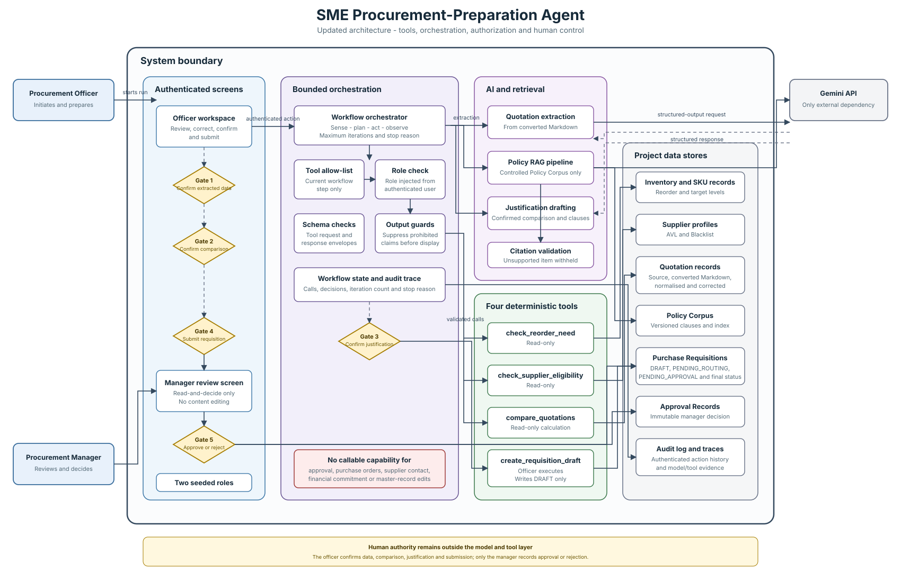

# Updated Architecture Diagram

| Field | Value |
|---|---|
| Week | 4 |
| Owner | Ainamani Jim Isaac |
| Due | 25 September 2026 |
| Status | Done |
| Path | `docs/architecture/architecture.md` |

## Brief requirement

Update the system architecture to include tools/function calling, the orchestration layer,
authorization boundaries and human-approval gates. The Week 1 context diagram remains
[`context-diagram.md`](context-diagram.md).

## Architecture

The diagram is limited to components, users, data and controls already defined by the Project
Charter, AI Boundary Matrix, Requirements Document, RAG implementation and Week 4 tool
catalogue. It represents the approved target architecture; it does not claim that every
connection is already implemented.

## Orchestration and tool boundary

The Procurement Officer initiates every run. The bounded workflow orchestrator controls the
order of steps, maximum iteration count and stop reason. Gemini cannot call a tool directly.
A proposed tool call passes through the current step's allow-list, authorization using the role
injected from the authenticated user, request-schema validation and response validation. Output
guards suppress prohibited approval, award or financial-commitment claims before display.

The diagram contains exactly the four tools specified in
[`tool-catalogue.md`](tool-catalogue.md):

| Tool | Authorized use | Side effect |
|---|---|---|
| `check_reorder_need` | Read current inventory and calculate reorder quantities | None |
| `check_supplier_eligibility` | Read supplier status and quotation validity | None |
| `compare_quotations` | Calculate and rank Landed Cost | None |
| `create_requisition_draft` | Agent may propose; Procurement Officer executes | Creates one requisition in `DRAFT` |

The Procurement Manager does not operate the agent loop. Approval and rejection are actions on
the dedicated read-and-decide screen, not callable tools. No tool can approve a requisition,
issue a purchase order, contact a supplier, commit funds or alter master records.

## Human-controlled transitions

The five gates shown in the SVG correspond directly to explicit human actions in the project
requirements:

1. **Confirm extracted data:** the Procurement Officer reviews and corrects Normalised
   Quotations before eligibility checks or calculations.
2. **Confirm comparison:** the Procurement Officer confirms the Landed Cost comparison before
   policy retrieval begins.
3. **Confirm justification:** the Procurement Officer edits and confirms the grounded draft
   before the requisition is compiled in `DRAFT`.
4. **Submit requisition:** the Procurement Officer explicitly submits the compiled requisition,
   allowing deterministic routing through `PENDING_ROUTING` to `PENDING_APPROVAL`.
5. **Approve or reject:** the Procurement Manager records the final decision. Rejection requires
   a rationale, and either decision creates an immutable Approval Record.

No requisition progresses beyond `DRAFT` without human action. The system stops after recording
the manager's decision; purchasing, payment and supplier contact remain outside scope.

## AI and deterministic responsibilities

Gemini is used only for the three model responsibilities in the project baseline: quotation-field
extraction, policy-grounded explanation and justification drafting. The Policy RAG pipeline reads
only the controlled, versioned Policy Corpus, and citation validation withholds an item containing
an unsupported citation.

Deterministic software owns file conversion, schemas, supplier eligibility, currency and unit
normalisation, financial arithmetic, ranking, requisition compilation, status routing and audit
records. The model receives computed figures; it does not calculate financial values.

## Project data shown

The data-store column contains only records named by the project documents:

- inventory and SKU records;
- supplier profiles, including the Approved Vendor List and Blacklist;
- source, converted, normalised and officer-corrected quotation records;
- the versioned Policy Corpus and its index;
- Purchase Requisitions and their status history;
- immutable Approval Records; and
- the audit log and model/tool execution traces.

All project data is synthetic. There is no live ERP, supplier, payment or external notification
integration.

## Implementation boundary

Quotation extraction, the Policy RAG pipeline and the four deterministic tools are working
components. The tools run behind `dispatch.invoke`, which injects the caller's role, enforces the
allow-list, validates requests and records a trace
([`working-tools.md`](working-tools.md)); the officer confirmation before
`create_requisition_draft` is enforced and tested.

Not yet implemented: the bounded agent loop and its state machine (Week 5), so the allow-list is
currently the full catalogue rather than per step; model-proposed tool calls; output-schema
validation at the dispatcher (failure FA-10 in [`tool-failure-tests.md`](../evaluation/tool-failure-tests.md));
and Gates 1, 2, 4 and 5, which are specified but have no screens yet.

Related specifications:

- [`project-charter.md`](../requirements/project-charter.md)
- [`ai-boundary-matrix.md`](../requirements/ai-boundary-matrix.md)
- [`agent-task-contract.md`](../requirements/agent-task-contract.md)
- [`tool-catalogue.md`](tool-catalogue.md)
- [`working-rag-pipeline.md`](working-rag-pipeline.md)
- [`context-diagram.md`](context-diagram.md)
