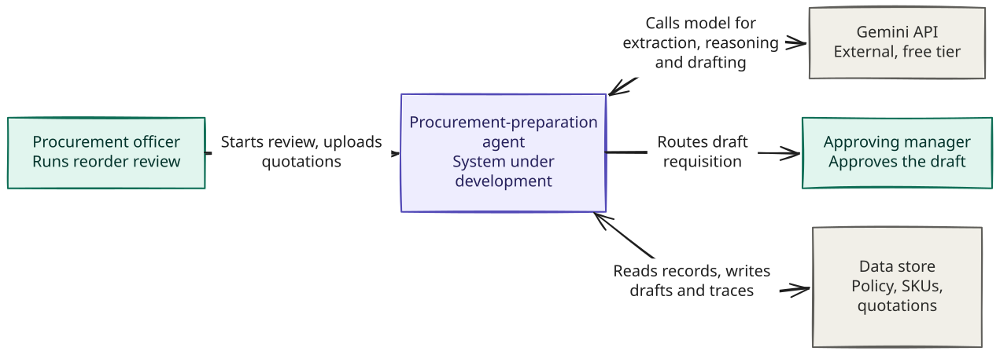

# Architecture / context diagram

*Context diagram of the SME procurement-preparation agent.*

## System context

The context diagram defines the system boundary for the eight-week project.
Everything inside the boundary is developed by the team, while everything outside
represents a person or service that interacts with or supports the system.

### Procurement officer

The procurement officer is the only person who operates the system. They start a
reorder review for a category or date, provide supplier quotation documents, confirm
figures when the system is unsure about an extraction, and enter values manually when
a document cannot be converted. The officer starts every run. The agent does not run
on a schedule or act on its own.

### Approving manager

The approving manager has the financial authority to review the completed requisition,
but does not use the agent directly. The system only sends the completed requisition to
the manager for approval. The agent cannot approve the requisition or see what happens
after it is sent.

### Data store

The data store contains all persistent project data. This includes the procurement
policies, inventory and SKU records with their reorder points, supplier profiles and
eligibility status, supplier quotations, converted quotation documents, requisition
drafts and audit records. The system reads reference information from the store and
writes its results back to it. All data is synthetic and created by the team. There is
no connection to a live ERP, inventory system, or supplier system.

### Gemini API / foundation model

The Gemini API is the system's only external dependency. It is used where a language
model is needed: extracting structured information from converted quotation text,
finding and applying the relevant procurement policies, and drafting the justification
for a requisition. The agent communicates with the model through a limited tool-calling
loop rather than a single request.
