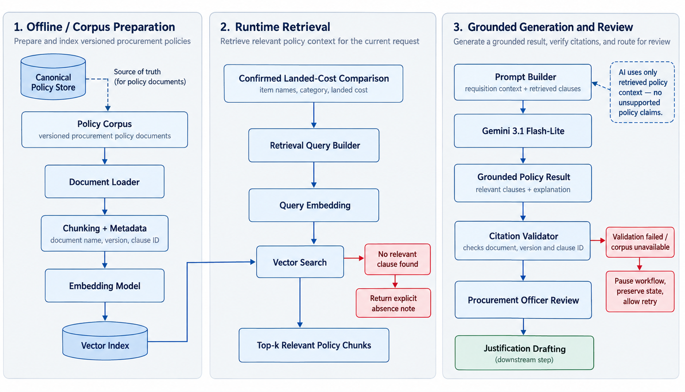

# RAG ARCHITECURE DIAGRAM

The procurement policy RAG pipeline works in three stages.

First, in **Offline / Corpus Preparation**, the system takes the versioned procurement policy documents, loads them, splits them into smaller chunks, attaches metadata such as the document name, version, and clause ID, then creates embeddings and stores them in a vector index.

Second, in **Runtime Retrieval**, the confirmed landed-cost comparison provides the current procurement context, such as the item, category, and landed cost. The system builds a retrieval query, converts it into an embedding, and searches the vector index for the most relevant policy clauses. If no relevant clause is found, the system returns an explicit absence note instead of inventing a policy rule.

Finally, in **Grounded Generation and Review**, the retrieved policy chunks are combined with the requisition context and sent to Gemini. Gemini uses only this retrieved policy context to produce a grounded explanation. A citation validator then checks that the referenced document, version, and clause ID are valid before the result is shown to the Procurement Officer. If validation fails or the corpus is unavailable, the workflow pauses and preserves its state for retry. After officer review, the process can continue to justification drafting.
